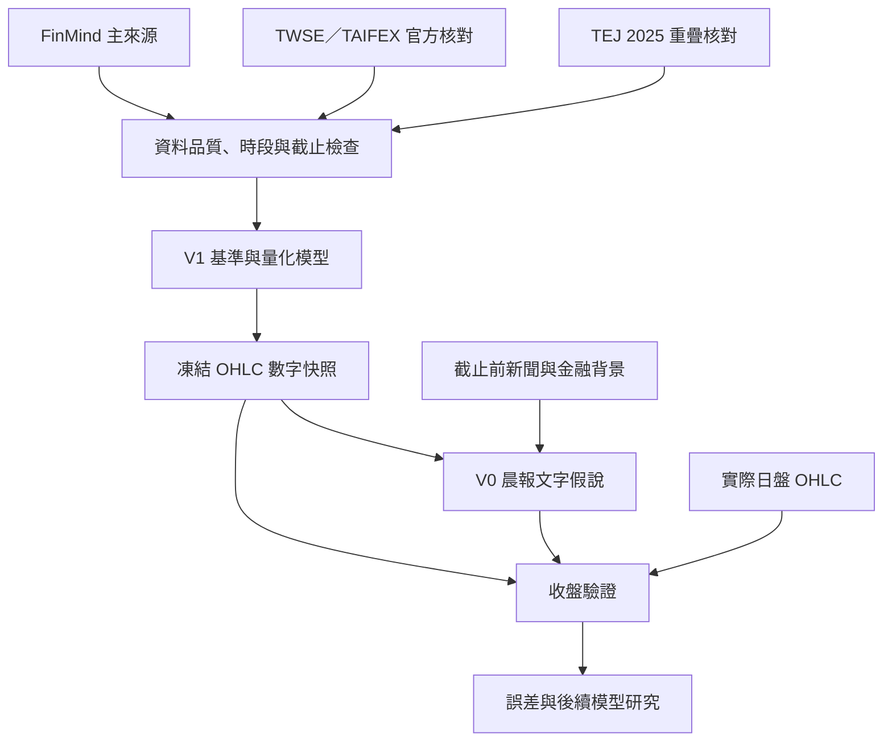

# 台股日盤 OHLC 量化預測與晨報

Repository：https://github.com/fu06pi/tw-market-scenario-engine  
架構與實作狀態更新：2026-10-16。

本專題將既有 V1 改造成台灣加權指數（TAIEX）與指定月份台指期（TX）的日盤 OHLC 量化預測引擎。經 live 資料查核後，FinMind 成為主要增量 API，TWSE／TAIFEX 官方資料負責權威核對，TEJ 實際可得的 2025 重疊期保留作第三方交叉驗證。研究 TimesFM 3.0 零樣本推論，並與簡單基準、ARIMA／ARIMAX 比較；任何自訂梯度測試會和官方微調明確分開。盤前先保存數字，再由原本 V0 晨報流程加入截止前新聞、國際局勢及金融數據，生成文字假說；收盤後比對同一份盤前結果。

**目前已完成資料品質、基準回測、TimesFM validation lock、唯一一次 final test，以及一次 retrospective Sheet staging端到端驗證。** Certified FinMind／官方資料在 2018-01-01 至 2026-10-08 通過回溯 DQ。TimesFM final總驗收為 `FAIL`：TAIEX close MAE較 paired baseline惡化 4.64%，TX只改善 0.45%，區間 coverage亦未全部達到 75%下限；因此不再用這個 final調參，預設保留鎖定最強 baseline。2026-10-08 shadow已在獨立 staging Sheet驗證 A:F、O盤前寫入、G:N、P收盤回填與盤前欄位不變；仍須 3–5 個交易日 genuine forward shadow，正式晨報切換尚未進行，`production_switch=false`。

## 文件與版本角色

- [AGENTS.md](AGENTS.md)：工程與研究執行規則。
- [CODEX_HANDOFF.md](CODEX_HANDOFF.md)：下一階段實作順序與交接。
- [PROJECT_STATUS.md](PROJECT_STATUS.md)：已完成與待完成項目。
- [V1→V0／V01 遷移契約](docs/V1_V0_MIGRATION_CONTRACT.md)：已核對的外部任務、legacy 欄位處理、切換門檻與 rollback 邊界。
- [外部任務切換套件](docs/V0_EXTERNAL_TASK_CUTOVER_PACKET.md)：三個既有任務的待審查 prompt、依賴順序、失敗處理與 rollback；目前為 `NOT_AUTHORIZED`。
- [原 OHLC 架構方案](docs/architecture/TW_OHLC_QUANT_ARCHITECTURE.md)：2026-10-07 的設計背景；其中「TEJ 暫緩」、實作順序與未固定門檻，以本文件及 AGENTS.md 的新決策為準。
- 其他舊情境、V0 isolation、KPI 與研究文件保留作歷史參考；與新流程衝突時，以本次新決策為準。

V1 負責數值、訓練、回測與預測快照；V0 負責依快照產生晨報與文字復盤。使用者所稱 V01 視為原本晨報流程的稱呼，實作前需確認實際介面，不能假設 repo 已存在名為 V01 的模組。

## 新流程



模型改版只影響後續預測。新聞第一階段只補充解釋，不修改數字；歷史新聞具備可驗證時間戳後，才能另做數值特徵增益實驗。

## 預測任務

| 項目 | 固定要求 |
|---|---|
| 標的 | 官方 TAIEX；依事前固定換月規則選定的 TX 月份合約 |
| 目標 | 當日日盤開盤、最高、最低、收盤，共八個價位 |
| 時區 | Asia/Taipei |
| 資料截止 | 交易日 08:30 |
| 數字保存 | 08:40 前完成持久化；遲到另標失敗，不補成正常盤前樣本 |
| 預測長度 | 一個交易日 |
| TX 口徑 | 日盤與夜盤分開；最後成交價與結算價分開 |

加權指數不能以 ETF 替代；日 OHLC 無法判斷高低點先後、盤中趨勢型態或市場廣度。文字可以列待驗證情境，但不能宣稱它們是 OHLC 模型已預測的結果。

## FinMind、官方資料與 TEJ

1. FinMind 使用 `TaiwanStockPrice`／`TAIEX` 與 `TaiwanFuturesDaily`／`TX`。`position` 是日盤、`after_market` 是夜盤；保存明確 `contract_date`，不使用連續合約代替同合約參考價。
2. `FINMIND_TOKEN` 可選；`TEJ_API_KEY` 只供 TEJ overlap。兩種憑證都不得進入 Git、日誌、快照或報告。
3. FinMind 請求按年或更小區間增量下載，保留 raw response、request、API status、擷取時間與內容 hash；schema 或 status 異常立即失敗。
4. 以 TWSE／TAIFEX 官方資料逐日核對 OHLC、時段、最後成交價、結算價及 open interest。FinMind Free 資料須標示來源、僅作非商業研究且不得散布 raw data。
5. TEJ 已驗證可連線，但本帳戶的 TAIEX／TX 查詢只在 2025 有實際 rows，因此只作重疊核對，不補造 2018-2024 資料。
6. 候選歷史起點為 2018 年，終點為最新完整交易日；保存來源、交易日、實體時段、合約、擷取時間、歷史可用時間與其依據。今天下載舊資料的時間不能代替歷史可用時間。
7. 檢查缺漏、重複、休市、異常尺度及 OHLC 關係；缺漏不填成零報酬，休市不建立虛構 K 棒。官方／FinMind 夜盤的 `settlement=0` 表示不適用，不能當作正價格或整批資料錯誤。
8. TX 報酬先於同合約內計算，再依固定換月規則拼接；參考前收使用被選合約自己的前一日盤收盤。

已結束夜盤及最近已收盤美股，依台灣當天早上真正可取得的時間對齊到當日特徵，保留海外休市與資料距今時間。禁止用相同日曆日期直接合併跨市場日線，或輸入當日日盤、未公布實際值與事後修訂資訊。

## 目標表示與模型

比較兩種 OHLC 表示法：相對前收的 OHLC 變化加價格約束；以及以下四個目標。令 P 為同標的／同合約前一日盤收盤：

| 目標 | 定義 |
|---|---|
| g | ln(O/P) |
| b | ln(C/O) |
| u | ln(H/max(O,C)) |
| d | ln(min(O,C)/L) |

對 u、d 使用經驗證的可逆非負轉換，還原保持非負。還原為 O=P×exp(g)、C=O×exp(b)、H=max(O,C)×exp(u)、L=min(O,C)×exp(-d)。所有輸出須為正，且 H≥max(O,C)、L≤min(O,C)。

對照至少包含：零報酬與歷史振幅、夜盤簡單回歸、ARIMA／ARIMAX、TimesFM 3 零樣本歷史版、多變量版與歷史微調版；先測市場獨立，再測聯合預測。共享外部特徵的模型使用相同資訊集。

TimesFM 3 是本專題指定研究目標。已固定 code commit `e51928e27119cb17bebc005be2696b75e0a9e688` 與 weight revision `43046b85ec22d584a13f8098c2ed39c889e129c2`。官方 3.0 高階介面為 inference-only；完整 LoRA 範例仍屬 2.5。自訂 `custom_output_head_gradient_smoke` 已在單一 train-period樣本執行一個 SGD step，證實 loss有限、output-head梯度／參數／預測改變及 checkpoint重載等價；這不是官方 fine-tuning、不證明改善，也不是 production candidate。公開摘要見 [`reports/quant/timesfm3-output-head-gradient-smoke-2026-10-15.json`](reports/quant/timesfm3-output-head-gradient-smoke-2026-10-15.json)。自架權重屬非商業授權，本專案維持學術研究與 shadow forward test。

## 訓練、驗證與停止

- 時間順序切分訓練、驗證及最終測試；資料充足時保留最近約一年作最終測試，選模前固定日期。
- 逐日 walk-forward：每次只使用當時已知資料。轉換、標準化、選模與校準不得偷看測試集。
- 「訓練直到一定準確率」指在訓練與驗證資料上迭代；鎖定候選後才跑最終測試。測試失敗不能反覆調同一測試集再當獨立證據。
- 先量測硬體、記憶體與耗時，記錄運算預算；不自行購買雲端運算。
- 使用 early stopping，保存驗證最佳 checkpoint。連續三輪無驗證增益或用完預算，停止搜尋並交付結果與瓶頸。
- 保存設定、資料版本、種子、權重版本、checkpoint、耗時與失敗，支援續跑。
- 預訓練資料重疊無法排除時，歷史結果標為回溯比較，另以固定模型的盤前前向測試補強。

## 驗收門檻

以下是研究目標，不是已達成績效或保證：

1. 在驗證集選定每個標的最強基準，再固定進入最終測試。兩標的收盤 MAE 均降低至少 5%。
2. 任一 O/H/L 的 MAE 不得比相同基準惡化超過 5%；八項價位分開列出。
3. 報告點數／bp MAE、RMSE、跳空、收盤報酬與振幅誤差；方向用事前中性門檻、混淆矩陣及簡單方向基準評估。
4. 名義 80% 邊際區間目標覆蓋率 75%～85%，同時比較 interval score 與寬度。四個目標的分位數不能直接拼成 OHLC 聯合分位數。
5. 時間區塊抽樣估計改善不確定性，按年度、波動、換月與重大事件檢查。報告全部應預測日、失敗日及覆蓋率。
6. 未達標仍交付最佳候選與完整結果，以最佳基準作預設候選輸出。預測達標不等於交易獲利。

## 晨報與每日作業整合

數字快照保存 forecast_id、交易日、合約、時段、截止／發布／持久化時間、前收、OHLC 與區間、資料品質、資料／程式／模型／設定版本及 hash。

原本 V0 晨報讀取同一 forecast_id 的數字，保留開盤前假說、實際開盤、實際盤中、實際盤後的用途與格式。模型輸入與新聞背景分開描述，不編造概率或另一套點數。若表頭已是「實際盤中」，儲存格不重複加同名標籤。

已核對的外部 `V1 台股劇本` 仍採 legacy 08:50 cutoff、Bull／Base／Bear 機率與盤中 regime；`財經事件晨報`、`V1 台股收盤驗證` 也尚未改讀新 OHLC 契約。這些欄位不會被當成新 V1 輸出。程式現在直接拒絕 08:50 narrative cutoff 與額外 probability 欄位；完整遷移表見 [`docs/V1_V0_MIGRATION_CONTRACT.md`](docs/V1_V0_MIGRATION_CONTRACT.md)。

`quant daily sheet-postclose-dry-run` 只產生 G:N、P 更新內容，並保存 A:F、O 的列指紋。寫入端必須先比對盤前列，再只更新保留的收盤欄位；任何 forecast_id、snapshot hash、標的／合約或 realization/evaluation 關聯不符都會停止。2026-10-15 staging readback摘要見 [`reports/quant/staging-sheet-validation-2026-10-15.json`](reports/quant/staging-sheet-validation-2026-10-15.json)。

目前 repo 另提供真正的 staging-only live 入口：`quant daily live-preopen` 只允許在08:20–08:29開始，先建立不可變FinMind capture並以TAIFEX當日夜盤核對，08:30後才預測、凍結、生成晨報及寫入staging A:F、O；`quant daily live-postclose` 在18:00後重新抓取FinMind實際日盤並以TWSE／TAIFEX核對，append realization/evaluation後只更新G:N、P。兩者皆逐欄readback、保存receipt，且 [`config/quant/staging.json`](config/quant/staging.json) 會拒絕正式Sheet ID。若資料晚於截止、官方核對不一致、Google憑證不存在、列非空或讀回不同，流程fail-closed並保存失敗attempt。

既有排程、Google Sheet 與歷史快照在開發期間保持運作。新資料、模型、數字保存、晨報及收盤更新通過端到端驗證後，才切換資料流；保留恢復版本。舊紀錄不回寫成新模型績效，新舊成績分開統計。

Codex heartbeat `ohlc-shadow` 目前為 `PAUSED`。先前在只有 retrospective staging 證據、尚未完成 live daily orchestration 時就啟用 heartbeat，順序不正確，因此已停用。重新啟用前必須先由單一 staging-only 執行入口完成 08:30 增量資料與 availability/cutoff 認證、DQ、body、seal/freeze、V0 narrative、Sheet write/readback，以及收盤 realization/evaluation；並至少手動完成一次 genuine live 交易日端到端驗證。失敗日必須保留，不能事後補成 forward PASS。正式 V0 排程仍獨立運作。

## 現有程式與實作路線

`src/tw_scenario/` 原有情境資料結構、固定權重 baseline、快照及評分仍保留。`src/tw_scenario/quant/` 已提供 contracts、providers、collection、quality、forecast、evaluation、backtest、TimesFM validation/final 及 daily integration CLI。研究結果仍是回溯證據，不能當作交易獲利或正式服務。

第一次官方收集的 dataset `fa3b3c0e5ddecb386b51446f0758efdff715e5b09d66ddcbe3c384b85e5be19e` 因 `settlement=0` parser 問題只留下 2,210 rows，缺 4,226 個 expected rows，資料品質結果為 `FAIL`。該資料集保留作失敗證據，禁止進入績效比較。最新執行狀態見 [PROJECT_STATUS.md](PROJECT_STATUS.md)，可重播工作目標見 [CURRENT_GOAL.md](CURRENT_GOAL.md)。

安裝與驗證：

```bash
python -m venv .venv
source .venv/bin/activate
UV_CACHE_DIR=/tmp/uv-cache uv sync --extra dev --extra research
UV_CACHE_DIR=/tmp/uv-cache uv run --frozen --extra dev pytest -q
UV_CACHE_DIR=/tmp/uv-cache uv run --frozen --extra dev ruff check .
python -m tw_scenario.cli evaluate examples/sample_prediction.json examples/sample_realization.json
```

Staging Sheet自主寫入使用Google Application Default Credentials，不把憑證放入repo或命令列：

```bash
UV_CACHE_DIR=/tmp/uv-cache uv sync --extra dev --extra research --extra sheets
export GOOGLE_APPLICATION_CREDENTIALS=/secure/path/staging-writer-service-account.json
UV_CACHE_DIR=/tmp/uv-cache uv run --frozen --extra sheets tw-scenario quant daily sheet-preflight-staging
UV_CACHE_DIR=/tmp/uv-cache uv run --frozen --extra research --extra sheets tw-scenario quant daily live-preopen \
  --date YYYY-MM-DD \
  --base-dataset-dir data/processed/CERTIFIED_DATASET_ID \
  --baseline reports/quant/experiments/EXPERIMENT_ID/baseline_results.json \
  --final-summary reports/quant/research-summary-final-2026-10-14.json
```

服務帳號只需分享獨立staging Sheet；不得授權正式Sheet。目前本機ADC尚未設定，因此writer程式已驗證但尚未完成genuine live Sheet寫入。

本階段可公開的實作／未執行邊界見 [`reports/quant/daily-engine-implementation-2026-10-16.json`](reports/quant/daily-engine-implementation-2026-10-16.json)。

鎖定最強 baseline已可直接建立真實資料 snapshot body；2026-10-08 retrospective shadow在約83秒完成 body→freeze→V0 narrative→A:P Sheet dry-run，且保持同一 forecast_id/hash。獨立 staging Sheet亦已完成晨報與收盤復盤逐欄 readback，確認收盤更新沒有改寫盤前 A:F、O；這仍是回溯演練，不是 08:40 前向發布證據。單一 live pre-open/post-close orchestration、自主 staging writer、cutoff/DQ與官方核對已實作並以fake transport測試；尚未執行genuine forward日，且本機ADC未設定。完成手動live staging E2E後，才可重新啟用heartbeat並累積3–5日forward shadow。TimesFM只保留研究結果，不因final失敗反覆調整同一測試集。

## 本次文件備份

改造前 README.md、AGENTS.md、CODEX_HANDOFF.md、PROJECT_STATUS.md 已連同來源 commit 與 SHA-256 清單備份：
[Google Drive 原始文件備份](https://drive.google.com/file/d/1UPYML3IeAbG40iw5FREPCORo-RP8f-98/view?usp=drivesdk)。

舊文件備份仍有效。自備份後已新增研究原型與 raw cache，但尚未切換正式排程。
