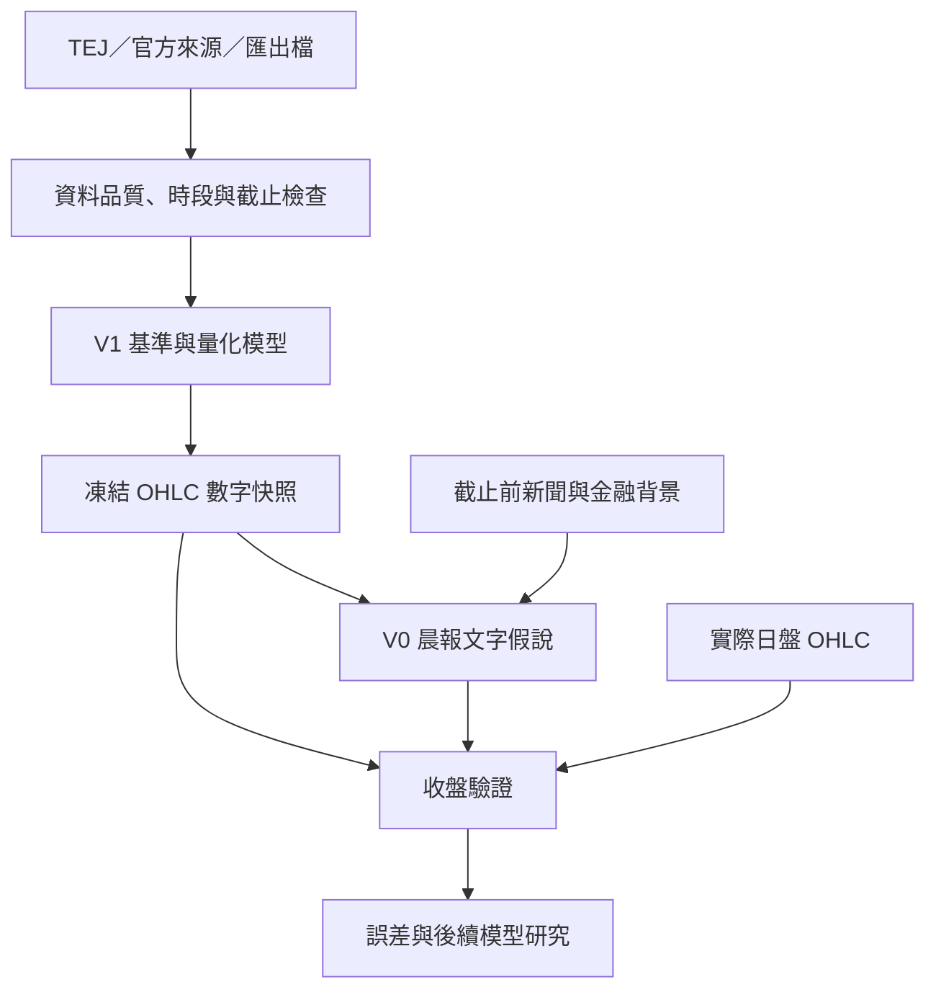

# 台股日盤 OHLC 量化預測與晨報

Repository：https://github.com/fu06pi/tw-market-scenario-engine  
架構決策更新：2026-10-11。

本專題以 TEJ API 取得歷史行情，將既有 V1 改造成台灣加權指數（TAIEX）與指定月份台指期（TX）的日盤 OHLC 量化預測引擎。研究 TimesFM 3.0 的零樣本推論與歷史微調，並與簡單基準、ARIMA／ARIMAX 比較。盤前先保存數字，再由原本 V0 晨報流程加入新聞、國際局勢及金融數據，生成文字假說；收盤後比對同一份盤前結果。

**目前是架構改造階段。TEJ API 已由使用者確認持有，但本次沒有連線驗證授權、下載資料、訓練模型或證明達標。** 既有程式是情境、快照與評分骨架，不能當成已完成的 TimesFM／ARIMA 模型。

## 文件與版本角色

- [AGENTS.md](AGENTS.md)：工程與研究執行規則。
- [CODEX_HANDOFF.md](CODEX_HANDOFF.md)：下一階段實作順序與交接。
- [PROJECT_STATUS.md](PROJECT_STATUS.md)：已完成與待完成項目。
- [原 OHLC 架構方案](docs/architecture/TW_OHLC_QUANT_ARCHITECTURE.md)：2026-10-07 的設計背景；其中「TEJ 暫緩」、實作順序與未固定門檻，以本文件及 AGENTS.md 的新決策為準。
- 其他舊情境、V0 isolation、KPI 與研究文件保留作歷史參考；與新流程衝突時，以本次新決策為準。

V1 負責數值、訓練、回測與預測快照；V0 負責依快照產生晨報與文字復盤。使用者所稱 V01 視為原本晨報流程的稱呼，實作前需確認實際介面，不能假設 repo 已存在名為 V01 的模組。

## 新流程



模型改版只影響後續預測。新聞第一階段只補充解釋，不修改數字；歷史新聞具備可驗證時間戳後，才能另做數值特徵增益實驗。

## 預測任務

| 項目 | 固定要求 |
|---|---|
| 標的 | 官方 TAIEX；依事前固定換月規則選定的 TX 月份合約 |
| 目標 | 當日日盤開盤、最高、最低、收盤，共八個價位 |
| 時區 | Asia/Taipei |
| 資料截止 | 交易日 08:30 |
| 數字保存 | 08:40 前完成持久化；遲到另標失敗，不補成正常盤前樣本 |
| 預測長度 | 一個交易日 |
| TX 口徑 | 日盤與夜盤分開；最後成交價與結算價分開 |

加權指數不能以 ETF 替代；日 OHLC 無法判斷高低點先後、盤中趨勢型態或市場廣度。文字可以列待驗證情境，但不能宣稱它們是 OHLC 模型已預測的結果。

## TEJ 與資料

1. 從環境變數 `TEJ_API_KEY` 讀取憑證。金鑰不得進入 Git、日誌、快照或報告。
2. 查詢帳戶實際資料表、欄位、額度、更新時間與歷史範圍；持有 API 不代表所有資料都已授權。
3. 候選歷史起點為 2018 年，終點為最新完整交易日；依共同覆蓋及品質決定實際起點。
4. 缺少必要欄位時，以可驗證官方 TWSE／TAIFEX 或匯出檔補足，記錄來源差異。
5. 保存原始資料與增量快取，以及來源、交易日、時段、合約、擷取時間、歷史可用時間與其依據。今天下載舊資料的時間不能代替歷史可用時間。
6. 檢查缺漏、重複、休市、異常尺度及 OHLC 關係；缺漏不填成零報酬，休市不建立虛構 K 棒。
7. TX 報酬先於同合約內計算，再依固定換月規則拼接；參考前收使用被選合約自己的前一日盤收盤。

已結束夜盤及最近已收盤美股，依台灣當天早上真正可取得的時間對齊到當日特徵，保留海外休市與資料距今時間。禁止用相同日曆日期直接合併跨市場日線，或輸入當日日盤、未公布實際值與事後修訂資訊。

## 目標表示與模型

比較兩種 OHLC 表示法：相對前收的 OHLC 變化加價格約束；以及以下四個目標。令 P 為同標的／同合約前一日盤收盤：

| 目標 | 定義 |
|---|---|
| g | ln(O/P) |
| b | ln(C/O) |
| u | ln(H/max(O,C)) |
| d | ln(min(O,C)/L) |

對 u、d 使用經驗證的可逆非負轉換，還原保持非負。還原為 O=P×exp(g)、C=O×exp(b)、H=max(O,C)×exp(u)、L=min(O,C)×exp(-d)。所有輸出須為正，且 H≥max(O,C)、L≤min(O,C)。

對照至少包含：零報酬與歷史振幅、夜盤簡單回歸、ARIMA／ARIMAX、TimesFM 3 零樣本歷史版、多變量版與歷史微調版；先測市場獨立，再測聯合預測。共享外部特徵的模型使用相同資訊集。

TimesFM 3 是本專題指定研究目標。實作前必須核對官方版本、權重、授權與訓練介面，固定 commit／revision；不能以舊版範例或視窗調整冒充 3.0 微調。若無法取得或驗證指定版本，記錄阻礙，完成資料與基準流程，不默默換版並宣稱完成。

## 訓練、驗證與停止

- 時間順序切分訓練、驗證及最終測試；資料充足時保留最近約一年作最終測試，選模前固定日期。
- 逐日 walk-forward：每次只使用當時已知資料。轉換、標準化、選模與校準不得偷看測試集。
- 「訓練直到一定準確率」指在訓練與驗證資料上迭代；鎖定候選後才跑最終測試。測試失敗不能反覆調同一測試集再當獨立證據。
- 先量測硬體、記憶體與耗時，記錄運算預算；不自行購買雲端運算。
- 使用 early stopping，保存驗證最佳 checkpoint。連續三輪無驗證增益或用完預算，停止搜尋並交付結果與瓶頸。
- 保存設定、資料版本、種子、權重版本、checkpoint、耗時與失敗，支援續跑。
- 預訓練資料重疊無法排除時，歷史結果標為回溯比較，另以固定模型的盤前前向測試補強。

## 驗收門檻

以下是研究目標，不是已達成績效或保證：

1. 在驗證集選定每個標的最強基準，再固定進入最終測試。兩標的收盤 MAE 均降低至少 5%。
2. 任一 O/H/L 的 MAE 不得比相同基準惡化超過 5%；八項價位分開列出。
3. 報告點數／bp MAE、RMSE、跳空、收盤報酬與振幅誤差；方向用事前中性門檻、混淆矩陣及簡單方向基準評估。
4. 名義 80% 邊際區間目標覆蓋率 75%～85%，同時比較 interval score 與寬度。四個目標的分位數不能直接拼成 OHLC 聯合分位數。
5. 時間區塊抽樣估計改善不確定性，按年度、波動、換月與重大事件檢查。報告全部應預測日、失敗日及覆蓋率。
6. 未達標仍交付最佳候選與完整結果，以最佳基準作預設候選輸出。預測達標不等於交易獲利。

## 晨報與每日作業整合

數字快照保存 forecast_id、交易日、合約、時段、截止／發布／持久化時間、前收、OHLC 與區間、資料品質、資料／程式／模型／設定版本及 hash。

原本 V0 晨報讀取同一 forecast_id 的數字，保留開盤前假說、實際開盤、實際盤中、實際盤後的用途與格式。模型輸入與新聞背景分開描述，不編造概率或另一套點數。若表頭已是「實際盤中」，儲存格不重複加同名標籤。

既有排程、Google Sheet 與歷史快照在開發期間保持運作。新資料、模型、數字保存、晨報及收盤更新通過端到端驗證後，才切換資料流；保留恢復版本。舊紀錄不回寫成新模型績效，新舊成績分開統計。

## 現有程式與實作路線

目前 `src/tw_scenario/` 提供情境資料結構、固定權重 baseline、快照及評分；現有 schema 屬舊情境介面。新增 OHLC schema／版本轉接，保持歷史相容，不能強行將舊記錄當新模型輸出。

計畫在既有 Python package 增加 providers、data/session/contract、features/asof、forecasters、training、backtest、calibration、registry 及 narrative 模組。這些是待實作設計，並非已存在的命令或功能。

現有骨架驗證：

```bash
python -m venv .venv
source .venv/bin/activate
python -m pip install -e '.[dev]'
python -m pytest -q
python -m tw_scenario.cli evaluate examples/sample_prediction.json examples/sample_realization.json
```

下一階段交付：TEJ 授權與資料品質報告、基準回測，再完成 TimesFM 推論／微調比較、最佳 checkpoint、重現 CLI、晨報接回與每日流程驗證。僅交付獨立模型而未接回原本晨報，不算整體目標完成。

## 本次文件備份

改造前 README.md、AGENTS.md、CODEX_HANDOFF.md、PROJECT_STATUS.md 已連同來源 commit 與 SHA-256 清單備份：
[Google Drive 原始文件備份](https://drive.google.com/file/d/1UPYML3IeAbG40iw5FREPCORo-RP8f-98/view?usp=drivesdk)。

本次只更新上述架構與交接文件；未執行模型訓練或切換正式排程。
