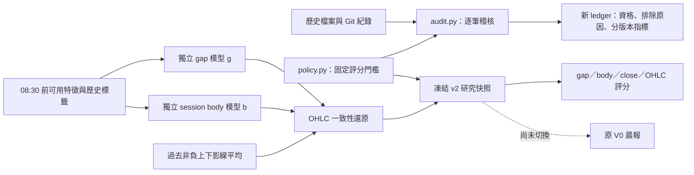

# 評分統一與開盤／盤中分離：2026-11-03 階段實作

這次完成使用者指定的前兩項修正：統一評分與樣本資格，並提供可執行的開盤／盤中分離研究架構。保留原本晨報、排程、歷史 JSON 與 legacy 介面。本階段沒有切換正式資料流，也沒有證明市場預測改善。

## 資料流與模組



`models.py` 繼續承接 legacy。新版資料契約與研究 forecaster 放在 `split_forecast.py`，不把舊情境資料冒充新模型輸出。

## 第一項：統一評分與樣本資格

- `config/targets.yaml` → `ScoringPolicy` 是 CLI／稽核共用門檻；新版快照同時保存該政策。評估新版時拒絕事後換門檻。
- `evaluate` 只提供 `diagnostic_only` 分數。單日方向命中不代表該日可納入正式盤前績效。
- `audit` 新建 ledger，明列每份預測的來源、hash 方法、Git 儲存證據、逐項排除原因與衝突標記。
- 任一歷史明確排除標記為 False，即維持排除。另一份檔案的 True 不能把它提升資格；矛盾另列 warning。新的稽核結果不修改原檔。
- legacy 的資料截止為 08:50，產生及 Git 記錄須早於 09:00；新版為 08:30／08:40，時間一律轉 Asia/Taipei 後比較。兩組績效分開。
- 只有 `generated_at` 或 hash 不足以證明盤前存在。Git 文件初次加入的時間與原始內容可作儲存庫證據；檔案有後續內容變更、目前工作目錄與初版不符、記錄時間早於宣稱生成時間時排除。
- Git commit 的時間戳不是第三方公開發布時間證明。ledger 保留此限制；不能以此宣稱已完成所有正式驗收。
- 缺實際結果、損壞 JSON、遲到、重建、日期不一致與完整性失敗均保留在 ledger；沒有有效樣本的指標為 null，並附 n=0。
- 彙總按 schema／市場／合約／model／feature／prompt／設定 hash 分開，提供樣本數、方向混淆矩陣及 gap／body／close 誤差。coverage 只代表看見的檔案，尚非完整交易日排程覆蓋率。

### 雜湊相容與不可覆寫

legacy 的原始 JSON hash 與過去 Pydantic 正規化 hash 分別檢查，回報使用哪一種方法。原始 `155` 與正規化後的 `155.0` 不會再被誤認為一定遭到修改。normalized 相容路徑會拒絕被舊模型丟棄的額外欄位，包含巢狀欄位。

新版明示 `hash_version=sha256-json-v2`，先完成型別化與序列化，再計算 hash；不回退至 legacy 演算法。`verify` 失敗時回傳非零 exit code。

凍結與稽核輸出使用 exclusive create；既有路徑會失敗，避免併發檢查後覆寫。audit 亦拒絕將輸出寫入 predictions、realizations、data/manifests、reports/evaluations。

## 第二項：開盤與盤中報酬分離

令 P 為同標的／同合約的前一日盤收盤：

| 元件 | 目標 | 實作 |
|---|---|---|
| gap g | ln(O/P) | 獨立 StandardScaler + Ridge |
| body b | ln(C/O) | 另一組 StandardScaler + Ridge |
| upper wick u | ln(H/max(O,C)) ≥ 0 | 僅用允許的歷史標籤取平均 |
| lower wick d | ln(min(O,C)/L) ≥ 0 | 僅用允許的歷史標籤取平均 |

預設 gap 特徵為 night_return_bps；body 特徵為 previous_body_bps、previous_range_bps。各頭特徵與 alpha 在 `SplitConfig` 中事前指定，獨立擬合，預設至少 60 筆歷史樣本。這些只是可檢驗的研究設定，尚未證明是最佳選擇。

還原 O=P×exp(g)、C=O×exp(b)、H=max(O,C)×exp(u)、L=min(O,C)×exp(-d)。開高收低、開低收高都可以出現，收盤方向不會直接複製開盤方向。

body 的 O 只出現在歷史訓練標籤與收盤後評估。當日預測的兩個頭都只使用盤前特徵，沒有使用當天實際開盤。評估分列 gap、body 與 close；legacy 的 body 僅從既有兩個點估推導，明列為診斷值，不宣稱它原先由獨立模型產生。

### 時間與商品邊界

- 所有特徵保存 observed_at、available_at、來源與 availability_basis，並驗證截止前可用。historical 類別不得放當日日盤資料；未完成的海外／夜盤觀測與重複特徵名稱會拒絕。
- 前收保存日期、可用時間、來源與可用時間依據。今天下載舊資料的時間不能冒充歷史發布時間。
- 訓練日必須嚴格早於預測日，標籤在當次截止前已可用，日期不可重複；禁止混合市場與 feature_version。
- TX 明示 YYYYMM 合約，前收必須同合約；訓練 label 必須與該列 inputs 的市場、合約及交易日一致。可以使用不同月份的歷史訓練列，但每列都必須是同合約內報酬。
- 本階段尚未實作交易所日曆、夜盤原始資料歸屬、選月／換月規則或 provider。這些需由資料層完成；新模型不會自行猜測合約或補零。

## 重現指令

從 repository 根目錄使用原 Python package：

```bash
python -m pip install -e '.[dev]'
python -m pytest -q
python -m ruff check src tests examples/split_demo.py
python -m tw_scenario.cli audit . reports/generated/audit-v2.json
python -m tw_scenario.cli verify predictions/2026-11-02.json --details
```

audit 輸出路徑必須尚不存在。已提交的紀錄見 [2026-11-03 ledger](../../reports/audits/2026-11-03-eligibility-v2.json)。ledger 內保留執行版本與程式碼 SHA-256，方便核對產出時使用的實作。

### 合成資料端到端範例

以下範例只驗證資料流、獨立模型及契約，不是市場績效：

```bash
python examples/split_demo.py /tmp/tw-split-demo
python -m tw_scenario.cli forecast-split \
  /tmp/tw-split-demo/training.json /tmp/tw-split-demo/request.json \
  /tmp/tw-split-demo/forecast.json --config /tmp/tw-split-demo/config.json
python -m tw_scenario.cli verify /tmp/tw-split-demo/forecast.json --details
python -m tw_scenario.cli evaluate \
  /tmp/tw-split-demo/forecast.json /tmp/tw-split-demo/actual.json
```

範例目錄中的檔案必須尚不存在。合成輸入、標籤與來源都有 synthetic 標示，不會加入歷史績效。Schema 分別見 `schemas/preopen_inputs.v2.schema.json`、`schemas/ohlc_split_forecast.v2.schema.json`、`schemas/market_realization.v2.schema.json`。

未來保存研究快照使用 `predictions/v2/YYYY-MM-DD-TAIEX.json` 或 `YYYY-MM-DD-TX-YYYYMM.json`。對應 actual 放 `realizations/v2/`，用相同名稱，必須包含市場／合約／可用時間與來源。audit 不會拿 legacy 的日級旗標或 TAIEX actual 代替新版 TX 資料。

## 已執行與仍待驗證

- 原有 4 項測試先通過；目前共 55 項通過，涵蓋相容性、竄改、覆寫、時間截止、合約隔離、訓練時間順序、開收盤反向、獨立頭、無效實際結果仍計入分母與 CLI 全流程。
- 已實際稽核 20 份預測：6 份依儲存庫證據符合 legacy 條件；未合併不同版本計算一個總命中率。這不是新版模型達標證明。
- 同步 11／3 遠端紀錄後，另保存 [最新 21 份 ledger](../../reports/audits/2026-11-03-eligibility-v2-latest.json)。來源 commit、實作 SHA-256 與執行版本均保留；原 20 份報告仍保留為先前批次。
- 同批 21 份快照的舊正規化 hash 驗證通過 11 份，相容驗證通過 19 份；10／1、11／3 仍未通過，沒有放寬時間或樣本納入條件。此為驗證相容性改善，不是預測命中率。詳見 [推送前驗證紀錄](../../reports/verification/2026-11-03-architecture.md)。
- 10／27 缺 actual。嘗試取得 TWSE 指數日 OHLC，但執行環境網路與查詢工具均未取得可驗證回應，保留 missing_actual，不猜測補值。
- 已執行合成資料 fit／forecast／freeze／verify／evaluate；可產生開高收低。
- 尚未取得足以訓練此契約的真實歷史特徵資料，未實做真實 walk-forward 成效比較、TimesFM／ARIMA、區間校準或 V0／Sheet／排程切換。
- 高低點目前為歷史影線基準，不是完整高低點模型；沒有聯合分位數或名義 80% 區間，不得宣稱滿足原 OHLC 驗收。

下一個實證步驟是建立具有歷史可用時間證據的資料 adapter，固定 train／validation／final-test 日期，再比較原方法與 split 候選。需要同時檢查幅度、方向、波動環境、失敗日與不確定性；這次的合成測試不能回答真實準確率是否提高。
