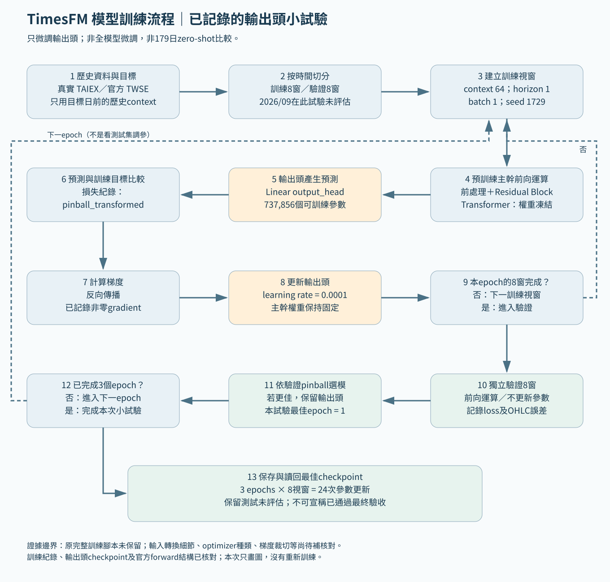
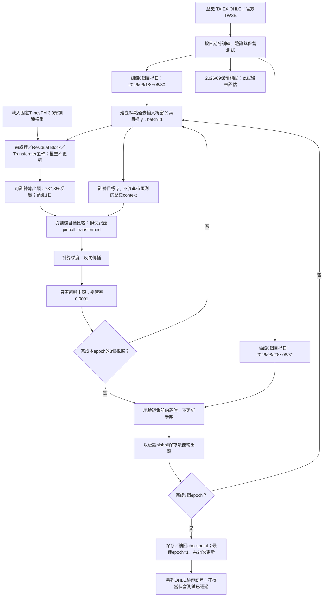
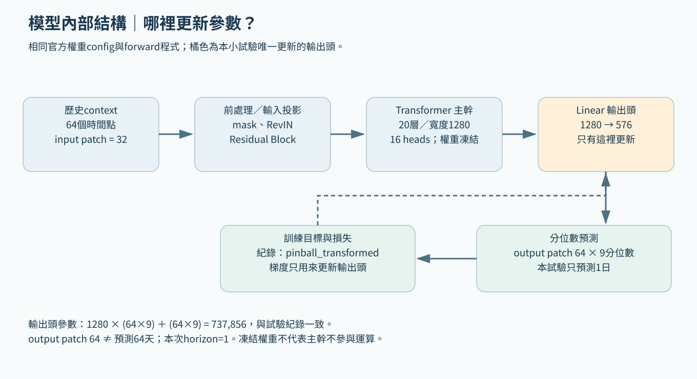
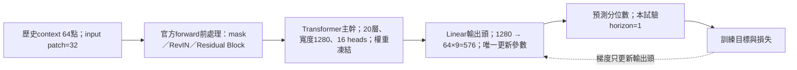

# 模型內部訓練流程：TimesFM 輸出頭小試驗

教授要求的流程圖呈現模型如何訓練。專題的資料收集、晨報及收盤驗證另見[系統流程圖](PROJECT_FLOW.md)。

## 圖的範圍

主圖依本機真實TAIEX小試驗紀錄與相符checkpoint整理。這是固定TimesFM 3.0預訓練主幹、只更新輸出頭的訓練；不是全模型微調完成，也不是後來兩市場各179日的zero-shot比較。

訓練流程圖的 Mermaid 圖源

驗證集可以選checkpoint，但不能用保留測試反覆選模。3個epoch是本小試驗的實際紀錄，不稱為「訓練到目標準確率」或聲稱已實作early stopping。

## 模型內部結構與參數更新位置

模型內部結構的 Mermaid 圖源

架構數字來自相同權重revision的`config.json`與官方`TimesFM3Torch.forward`。輸出頭參數量為`1280×576＋576＝737,856`，與試驗紀錄一致。output patch長度64不等於本次預測64日；本試驗預測長度是1日。前處理與主幹仍參與前向運算，「凍結」是其權重不更新。

## 已核實設定與證據

| 項目 | 實際紀錄 |
|---|---|
| 權重 | `google/timesfm-3.0-pytorch`；revision `43046b85ec22d584a13f8098c2ed39c889e129c2` |
| 資料 | 真實TAIEX，官方TWSE；資料紀錄179列，不代表179個訓練視窗 |
| 訓練／驗證 | 各8個視窗；分別2026/06/18～06/30、08/20～08/31 |
| context／horizon | 64／1；batch=1；seed=1729 |
| 更新範圍 | output_head_only，737,856參數 |
| 學習率／更新 | 0.0001；3個epoch×8視窗＝24次optimizer step |
| 梯度／參數變化 | max gradient L2=0.0101353；last parameter update L2=0.0797300 |
| 選模 | 驗證pinball最佳為epoch1（0.00171505）；不是以最小收盤MAE選擇 |
| checkpoint | 本機SHA256 `def2ad1718c9bd9d27d0cad26cef47fed386c770e442218e8930a5d8daf2f340`，已重新核對；不散布權重 |
| 保留測試 | 原小試驗標記2026/09未評估；後來其他研究已見標籤，不得因此重新宣稱該月仍為全專題未見測試 |

在本次工作區找不到原小試驗完整訓練腳本，因此**無法重新核實輸入目標轉換細節、optimizer種類、梯度裁切、loss聚合及訓練mode切換**。本圖只標紀錄能支持的資訊；不將後來zero-shot的log(price/P)轉換，或舊版TimesFM範例的Adam設定，冒充此試驗的已證明實作。完整訓練重現仍須補回原腳本。

本地證據：`reports/generated/cloud/taiex-training-pilot.json`、對應`taiex-output-head-pilot.pt`。官方程式已快取於`/workspace/.cache/timesfm-official/src/timesfm3/torch/model.py`；`forward`依序呼叫`_preprocess`、`transformer_stack`、`output_head`。官方程式提供forward，不代表本專題的完整訓練迴圈已由官方驗證。

## 與專案其他模型區分

| 實驗／流程 | 是否有本地訓練與梯度更新 | 本圖適用性 |
|---|---|---|
| TimesFM輸出頭小試驗 | 有，24次，只更新輸出頭 | 主圖對象 |
| TimesFM兩市場179日zero-shot比較 | 無參數更新 | 只有前向推論，不套用backprop圖宣稱已微調 |
| Ridge歷史研究 | 有擬合，但以標準化＋L2回歸解參數 | 不使用TimesFM的Transformer／反向傳播流程 |
| 固定night_carry每日試跑 | 讀凍結checkpoint產生數字 | 本次盤前沒有重新訓練TimesFM |

向教授說明可用一句話：「我先用過去64點資料輸入TimesFM，固定預訓練主幹，只微調輸出頭；用訓練損失更新參數，以獨立驗證期選最佳checkpoint，最後把OHLC誤差分項評估。目前只有8訓練／8驗證的小試驗，完整訓練與重現腳本仍需補齊。」
