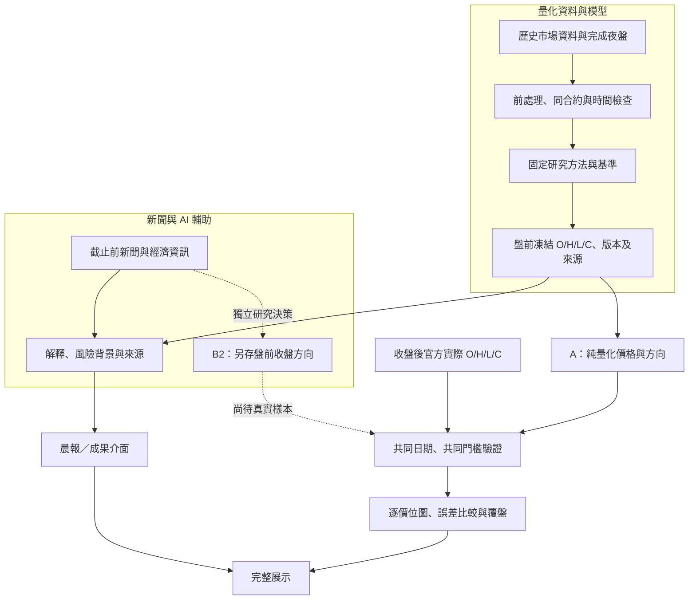

# 專題架構與資訊時間軸

**2026-11-23 範圍更正：**使用者指出所需流程圖是「模型內部訓練」。本文件是系統流程背景，不能替代該要求；請以[模型訓練流程](MODEL_TRAINING_FLOW.md)為主。

目的：建立盤前台股輔助判斷系統，以量化預測 O/H/L/C，結合新聞／經濟資訊研究判斷是否改善。先完成既有模型的驗證及展示，再進行模型擴充。

實線為既有量化／解釋流程；虛線為獨立新聞方向實驗，資料契約與評分已實作，尚未完成真實增益比較。圖示不是排程啟用或 Sheet 寫入證據。

| 時間／資料 | 正確說明 |
|---|---|
| 較長歷史 | 模型估計期間依研究計畫／checkpoint，不自動等於推論 context window |
| 每次量化輸入 | 前日 OHLC lag 與已完成夜盤；TimesFM 小試驗另有 64 個 context 點，不能混稱 |
| 新聞資訊 | 預先宣告查詢窗，保存發布／取得時間；兩者均須可支持盤前使用 |
| D日08:30 | 新流程資料截止，Asia/Taipei |
| D日08:40前 | 凍結數字及另存研究決策，延誤列失敗，不倒填 |
| D日收盤後 | 同日／市場／合約 actual，才能計算誤差 |

此次主要圖表用最初訓練至2025/09、驗證2025Q4、已見評估2026/01–09的原凍結研究。規則是每日擴展擬合；本次成果整理沒有重新訓練。圖上左側20個2025年12月點是驗證期的歷史背景，不標成新訓練成果。
